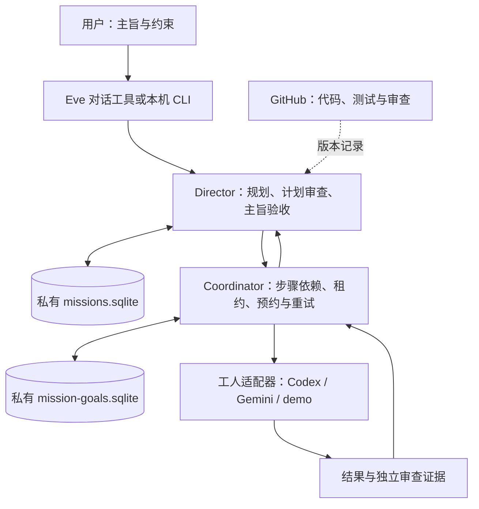

# 联盟长期目标总控：实现设计

状态：2026-10-25，两层本地实现已生成；真实模型连接与生产常驻仍按各自证据验收。任务入口：[ciaomind #6](https://github.com/utopia013-droid/ciaomind/issues/6)，运行方式见 [OPERATIONS.md](OPERATIONS.md)。

## 目标与归属

用户向自己管理的第三方总控下达一次主旨，总控持有状态、组织工人、检查证据，并在上限内调整计划。模型提供推理或执行能力；主旨、授权、验收规则和持久化状态保存在自有控制层，可以更换工人。

这是依据公开能力独立实现的系统，不依赖 Dots 账号资格，也不使用其私有控制接口。各家模型、CLI、工具和账号分别按正式接口授权；当前聊天中的插件连接不会自动转移给新服务。

## 两层结构

| 层次 | 已实现职责 | 验证边界 |
|---|---|---|
| Director | 接收不含手写步骤的主旨；规划、计划独立审查、子目标执行、原主旨验收与有上限的重规划 | demo 计划为固定合成逻辑，不能当成真实自然语言模型规划 |
| Coordinator | SQLite 状态、依赖计划、原子领取、租约、指纹、调用预约、暂停恢复与维护 | 本地恢复测试不代表目标主机已长期在线 |
| 适配器 | Codex 正式非交互 CLI、Gemini headless 和明确标注的 demo 子进程 | 程序存在、账号元数据和真实推理回执分别核验 |
| Eve | 主旨、子目标及状态管理工具；保留原文件交接工具兼容 | 自身模型认证与 daemon 工人认证分开；未给模型开放通用 shell 或自行验收工具 |

独立 orchestrator CLI 的显式目标使用 `goals.sqlite`；director 子目标默认使用 `mission-goals.sqlite`。同一子目标库只由一个调度 owner 管理，避免独立底层 daemon 在父主旨暂停后继续调度。

## 主旨与共同协议

主旨记录自然语言目标、原始验收、命名空间、允许能力、允许工人、规划者、不同的审查者、调用预约上限和规划周期上限。用户不必逐步催促正常推进。程序使用 JSON Schema、版本、摘要和轮次检查机器交接；模型不能补造授权或修改原始验收。

状态按 `plan → plan_review → child → final_review` 持久化。子步骤完成后仍须按原主旨独立验收；证据不足或子目标阻塞时，保存缺口并在上限内重规划。多个模型同意不能替代事实、测试或实际效果。完整字段与状态见 [PROTOCOL.md](PROTOCOL.md)。

## 权限、预算与故障恢复

初版 autonomous mission 仅允许明确只读的适配器与能力。工人只能接收其配置允许的命名空间、能力和必要上下文。规划者、产出者及审查者角色受程序检查；不同本地 ID 不自动证明不同远端账号或提供方。

调用预约、租约、事件和结果指纹跨进程保存。下层明确只读任务可在尝试上限内恢复；写入结果不明时不自动重做。上层未知阶段失租保守阻塞，先核对结果再显式重试。取消本地进程不能撤回已经发生的外部动作。

`max_calls` 约束适配器调用预约，包含规划与审查；它不是美元硬预算，也不等于工人内部模型步骤数。只有可信适配器明确报告尚未启动时才能退回对应预约，不能凭错误码猜测费用。调用、重试、维护和规划周期上限都不会在重启后自动扩充。

## 私有数据与常驻

`personal`、`project` 分别保存目标、检索范围和工人允许范围；这是单用户程序中的逻辑隔离。更强隔离需要独立数据目录、进程、凭据与执行节点，不能把命名空间当作多租户认证或磁盘加密。

真实主旨、个人原文、头像、声音、数据库、产出和凭据放在仓库外的私有环境。公共 GitHub 只放通用实现、合成示例、最少测试证据和可审查改进，不导入整份个人聊天或生活资料。

已提供串行轮询、终止信号处理及 systemd 用户服务模板；模板未自动安装、启用或启动。开发云工作区不承诺会话结束后常驻。生产在线、持久磁盘、退出登录、进程崩溃及机器重启恢复，需要在实际目标主机另行验证。

## 自我迭代

总控可以组织工人提出代码、提示词或调度策略改进。固定评测、独立复核、有限试运行和回滚通过后才升级。当前不会自行合并 PR、替换生产代码、放宽授权、改变主旨或修改成功标准。

## 当前实际连接状态

Codex CLI 0.163.0 已安装，登录元数据显示 ChatGPT；最小真实只读探针却返回 HTTP 401 / `AUTH_REQUIRED`，因此不能标为已接通。未通过新登录、付费 key 或其他厂家替代成功。Gemini 尚无真实安装及授权回执，跨厂商任务链路未验证。离线 demo、文档示例及程序检查的实际结果见 [VERIFICATION.md](VERIFICATION.md)，不能升级成真实模型或生产运行结论。
