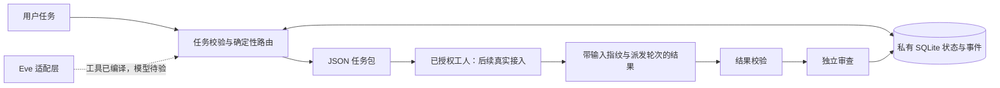

# 联盟协作代理：首版设计

状态：2026-10-25 开发方案；运行能力以本次 PR 的实际验收证据为准。开发任务：[ciaomind #6](https://github.com/utopia013-droid/ciaomind/issues/6)。

## 目标与依据

用户确认当前账号无法使用 OpenAI Dots，决定开发自己的持续协作能力，由主代理负责路线、分工和验收。第一版复用 CIAOMIND 任务台与 `openclaw-space` 联盟协议，建立任务接收、分派、结果回读和独立验收的闭环。

Dots 的公开说明用于识别可借鉴的产品能力。它不提供其私有源码、系统提示词、记忆算法或内部调度协议；本项目的架构与实现均自行设计。官方 Dots 账号资格不再是开发依赖，也不调用其私有接口。先前的 [Dots 开通准备 PR #25](https://github.com/utopia013-droid/openclaw-space/pull/25) 保留为历史参考，不作为自建代理已连接的证据。

## 首版边界

| 层次 | 首版职责 | 验证边界 |
|---|---|---|
| 任务底座 | 用 Node 内置 SQLite 保存任务、输入指纹、状态和事件 | 本地持久化验证不证明后台服务已常驻 |
| 调度 | 按任务类型确定目标工人，生成 JSON 文件任务包 | 指派目标不代表该工人账号已授权或在线 |
| 交付与验收 | 校验任务、输入版本、摘要、派发轮次和产出者；结果先进入待审查状态 | 本地身份字符串不能证明远端人员或服务身份 |
| 智能体适配 | Eve 的登记、派发及状态工具连接本地任务底座 | 类型检查与构建不能证明真实模型调用成功 |

首版不用模型也应能完成合成任务验收。真实模型、GitHub 自动写回、后台轮询、主动记忆和电脑操作均需分别接入与验证。

## 结构

调度规则与提供方适配保持独立。首版路由意向：代码任务交给 `codex`，办公任务交给 `workbuddy`，研究任务进入 `manual`，敏感任务进入 `human`。这些是任务包的目标标识，不宣称任何账号已连接；敏感任务不因被分派就获得执行许可。

## 输入、状态与结果契约

- 每个任务包含 `task_id`、输入版本、任务类型与输入；由任务底座计算规范化输入的 SHA256。
- 相同任务身份与相同输入重复提交应返回既有任务；内容冲突必须拒绝或显式建立新版本，不静默覆盖。
- 派发需原子记录轮次与目标工人；重复请求不产生第二次派发。任务文本只作为数据，不能拼接进 shell。
- 结果必须与当前任务身份、输入版本、摘要及派发轮次一致。拒绝过期轮次、错误指纹和不匹配的产出者。
- 有效结果先进入审查，产出者不能自行接受。独立审查未完成前，不把任务标为已验收。
- 暂停、恢复、失败与重试需要显式状态和审计记录。具体首版支持的操作以 CLI 帮助及测试为准，不把设计状态视为已运行能力。

## 权限与数据

私有任务输入、SQLite 数据库、个人记忆、结果文件和凭据保存在仓库之外；公共仓库只放实现、合成样例和最少验收证据。密钥仅用平台密钥库或运行环境注入，不写入任务包、日志或提交。

任务底座默认只生成文件，不自动发邮件、发消息、公开发布、付款、删除数据、修改授权或合并 PR。涉及这些动作时，由用户在具体结果与权限范围明确后确认。外部网页、Issue 和工人结果均视为任务数据，不能改变仓库规矩。

## 来源与验证状态

- [OpenAI Dots 官方公告](https://openai.com/index/introducing-dots/)：产品能力参考。
- [Dots 官方入门说明](https://help.openai.com/en/articles/20001530-getting-started-with-your-dot)：官方产品入口、资格及连接方式参考；不代表本项目获得这些能力。
- Eve 实现应以安装版本附带的 `node_modules/eve/docs/README.md` 及相关指南为准，不能依赖旧 API 记忆。
- 首版验收需附实际命令、结果与提交；本文本身不证明任何测试、模型连接或部署已完成。
